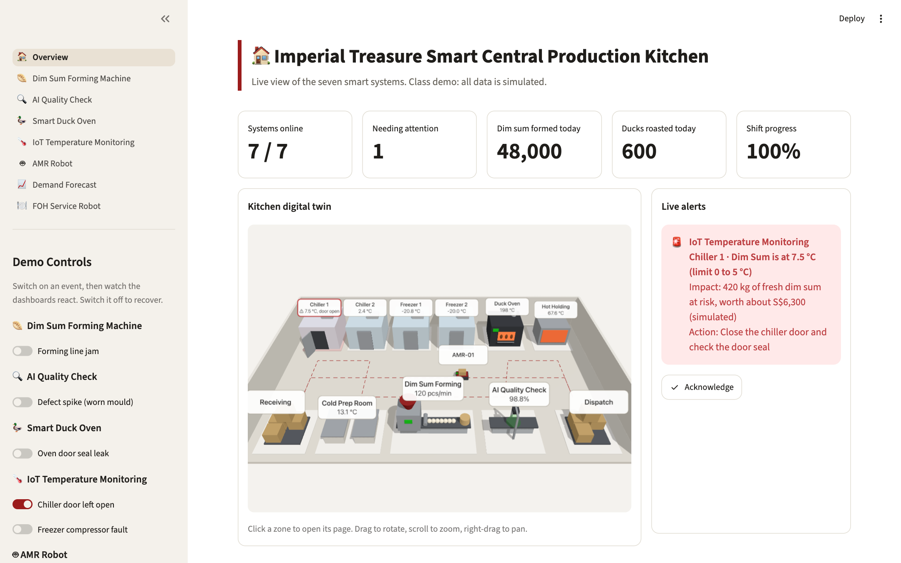
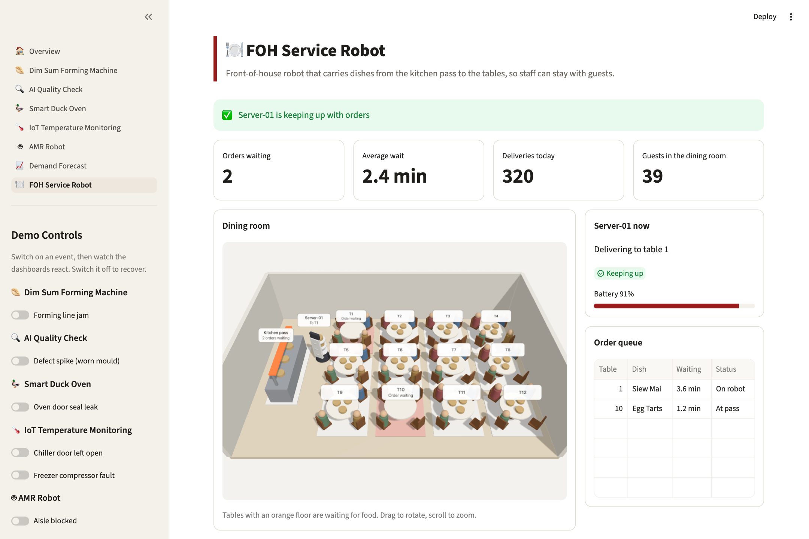
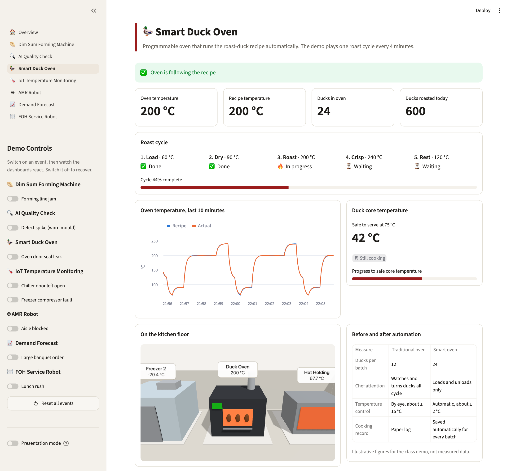

# Smart Central Production Kitchen

A live dashboard demo of a "smart" central kitchen for a restaurant group: seven
connected systems, a 3D digital twin of the kitchen floor, and one-click fault
scenarios to show how operators would see and handle problems.

Built with Streamlit and three.js as a class proof of concept.

> **All data is simulated.** Nothing here comes from real equipment or from
> Imperial Treasure. Every figure (temperatures, output, costs, before/after
> comparisons) is made up for the demo. This project is not affiliated with or
> endorsed by Imperial Treasure.



## What it shows

| Page | What you see | Fault you can trigger |
|---|---|---|
| **Overview** | Headline numbers, 3D kitchen twin, live alerts, alert log | Shows every system's alerts |
| **Dim Sum Forming Machine** | Throughput, piece weight spread, batch and hopper status | Forming line jam |
| **AI Quality Check** | Pass rate, defects by type, latest trays inspected | Defect spike from a worn mould |
| **Smart Duck Oven** | Roast cycle phases, oven vs recipe temperature, core temperature | Oven door seal leak |
| **IoT Temperature Monitoring** | Six cold and hot zones with safe limits | Chiller door left open, freezer fault |
| **AMR Robot** | Delivery robot moving through the kitchen, next stops, battery | Aisle blocked |
| **Demand Forecast** | 14 days of orders, 7-day forecast, tomorrow's production plan | Large banquet order |
| **FOH Service Robot** | 3D dining room with a serving robot, order queue, wait times | Lunch rush |



## Features

- **3D digital twin.** Rotate, zoom, and click any zone to open its page.
  Zones turn red when something is wrong, the chiller door swings open, and
  the robot moves in real time.
- **Demo Controls.** Sidebar switches trigger each fault. Switch one on and
  the charts, alerts and twin react within seconds; switch it off and the
  system recovers.
- **Alerts that explain themselves.** Each alert says what is wrong, what it
  puts at risk, and what staff should do.
- **Acknowledge workflow.** An operator can acknowledge an alert, and the
  Overview keeps a log of when each alert was raised, acknowledged and resolved.
- **Presentation mode.** Larger text and no Streamlit toolbar, for projecting.
- **Works offline.** three.js is included in the repo, so no internet is
  needed once the Python packages are installed.



## Run it

You need Python 3.10 or newer.

```bash
git clone https://github.com/yansong2025/Smart-Central-Kitchen.git
cd Smart-Central-Kitchen

python3 -m venv .venv
.venv/bin/pip install -r requirements.txt     # Windows: .venv\Scripts\pip
.venv/bin/streamlit run app.py                # Windows: .venv\Scripts\streamlit
```

The app opens at http://localhost:8501.

## Giving the demo

1. Start on **Overview**. Everything is green.
2. In the sidebar, switch on **Chiller door left open**. Within about 15
   seconds Chiller 1 turns red on the twin and an alert appears with the stock
   at risk and the action to take.
3. Click the chiller on the twin to jump to **IoT Temperature Monitoring** and
   show the temperature climbing past its limit.
4. Click **Acknowledge**, then switch the event off and watch it recover.
5. Scroll to the **Alert log** on the Overview to show the full history.
6. Repeat with any other system. **Reset all events** clears everything.

For projecting, switch on **Presentation mode** at the bottom of the sidebar
and collapse the sidebar with the « button.

## How it works

```
app.py            navigation and sidebar Demo Controls
ui.py             shared page elements: headers, cards, charts, alert banners
views/            one file per page
sim/              one simulator per system, plus events and the alert log
twin/             3D twins: Python builds the scene state, kitchen.js draws it
static/vendor/    three.js (MIT licence), served locally
smoke_test.py     headless check of every page and event
```

Every simulator is a plain function of the clock: given the current time and
which events are switched on, it returns the readings. There is no database
and no stored history, so every page always agrees and a restart loses nothing
but the alert log.

The 3D scenes contain no model files. The kitchen, dining room and robots are
assembled in code from boxes, cylinders and spheres.

To check everything still works after a change:

```bash
.venv/bin/python smoke_test.py    # about 40 seconds
```

[CLAUDE.md](CLAUDE.md) has the conventions and step-by-step notes for adding a
page, a demo event, or a zone on the twin.

## Built with

- [Streamlit](https://streamlit.io) for the app and pages
- [Altair](https://altair-viz.github.io) for charts
- [three.js](https://threejs.org) for the 3D twins
- pandas and NumPy for the simulated data
